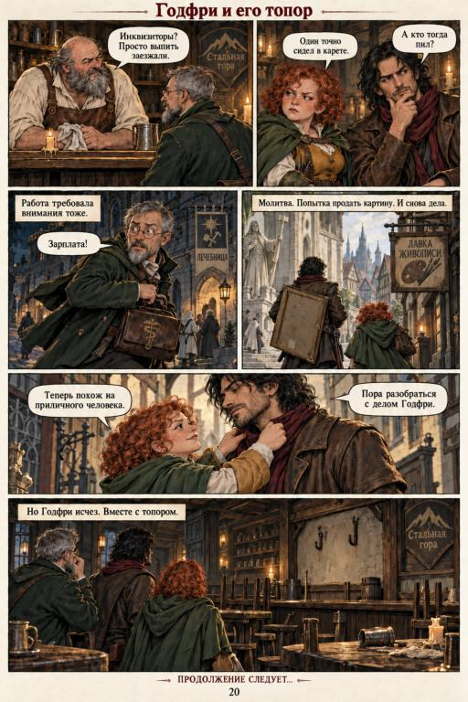
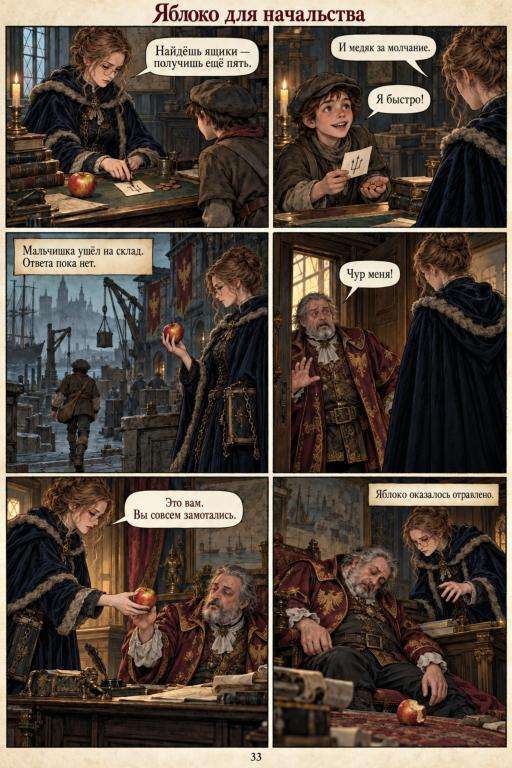
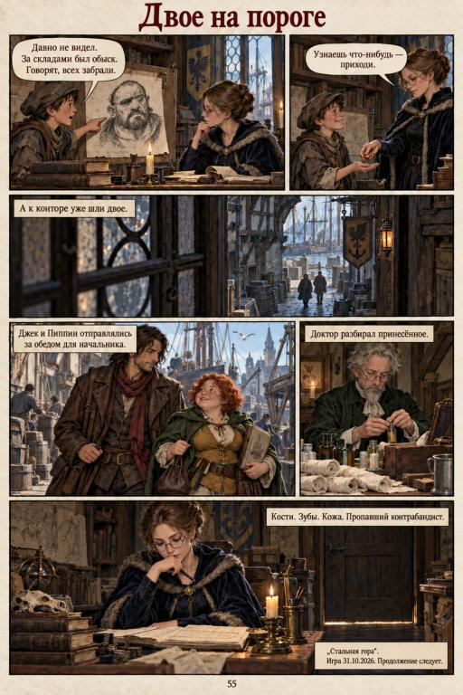

# Заметки по доступным страницам

Полностью прочитаны 8 страниц: №1 — PDF-страницы 19–20; №2 — PDF-страницы 13–15 (печатные 33–35); №3 — PDF-страницы 18–20 (печатные 53–55). Остальные страницы проверены визуально, но основная часть изображения закрыта чёрным полем из-за ошибок декодирования. Это разбор фрагментов, а не полный пересказ серии.

## Мир и подача

Доступные эпизоды показывают фэнтезийный портовый город: готические шпили, склады, корабли, таверны, стражу и бюрократические конторы. Палитра сочетает холодные серо-синие улицы с тёплыми свечными интерьерами. Реалистичная живописная манера, фактуры ткани и камня, повторяющиеся герои и многофигурные сцены создают цельную атмосферу. Тон диалогов ироничный; серьёзная интрига соседствует с бытовыми шутками.

## №1: доступный финал

На странице 19 Джек и его рыжеволосая спутница обнаруживают, что украшения исчезли вместе с Марком. Джек узнаёт нанесённый на стену знак, но уклоняется от объяснения. Годфри предлагает ягоды, вызывая резкую реакцию Джека. На странице 20 Годфри получает работу и затем замечает пропажу своего топора. Это оставляет несколько открытых сюжетных вопросов.

## №2: доступный финал

Персонаж в очках отправляет мальчика искать ящики, затем передаёт начальнику яблоко. Начальник теряет сознание; следующая страница подтверждает, что он жив. Пока кабинет доступен, персонаж находит сообщение о наборе команды на эльфийский корабль. Финальная страница показывает несколько параллельных линий: Годфри расспрашивает в таверне, архивариус ждёт известий, Джек и Пиппин находятся в бедном квартале, а Клаус ещё не выполнил приказ.

## №3: доступный финал

Джек и Пиппин обсуждают портрет разыскиваемого бородатого мужчины. Мальчик сообщает о ящиках с костями, зубами и кожей и вспоминает похожее имя — Зимунд или Зигвальд. Джек расспрашивает жителей и стражу; появляется версия о богатом подозреваемом. На последней странице мальчик рассказывает архивариусу, что мужчину у складов забрали, Джек и Пиппин идут к начальству за обедом, а доктор изучает принесённые останки. Подпись связывает открытые вопросы: останки и пропавший контрабандист.

## Что требуется для полного разбора

Исправные исходники остальных 47 страниц позволят восстановить завязку, проверить связи персонажей и последовательно разобрать интригу. На основании доступных фрагментов нельзя достоверно описать весь сюжет или оценить все переходы между эпизодами.
