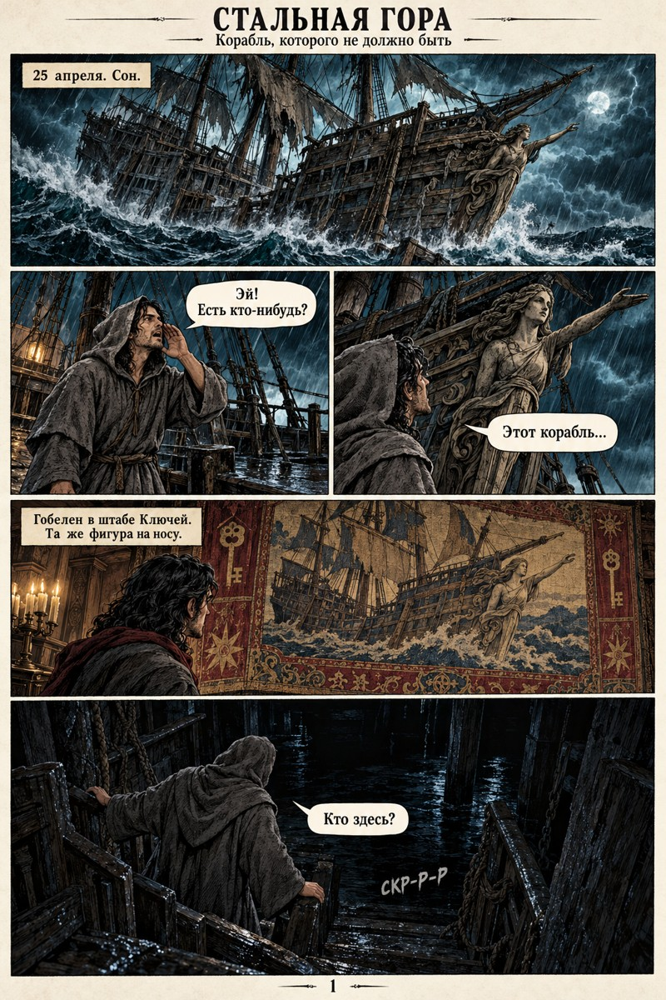
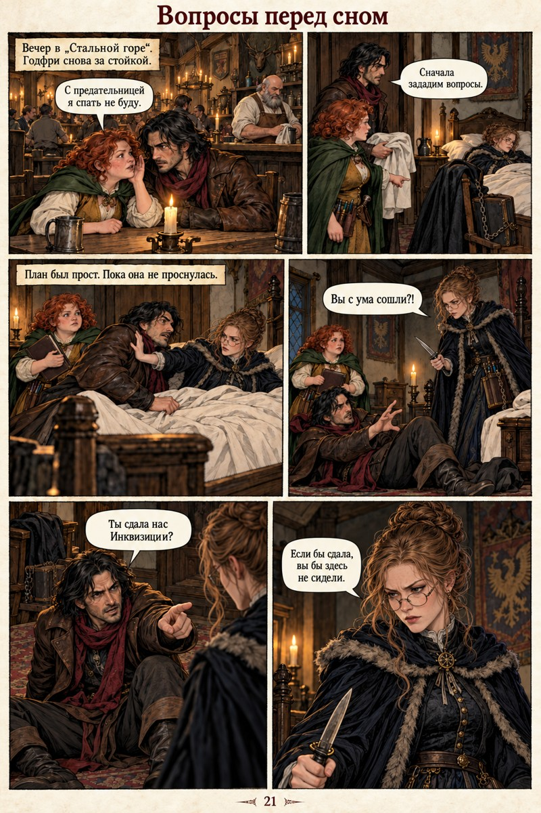
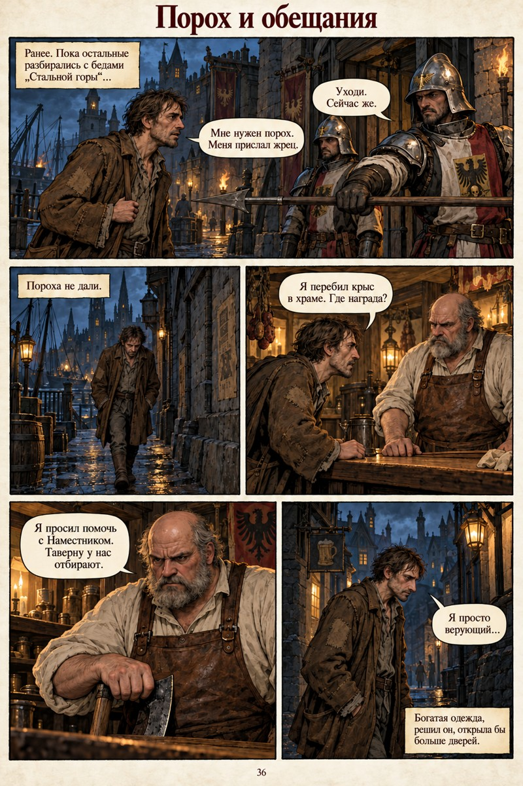

# Стальная гора — выпуски №1–4

Готический портовый город, корабли и таверны, инквизиция и городская канцелярия. Джек, Пиппин и доктор Попов постепенно оказываются связаны с исчезновениями, опасным грузом и тайнами городских властей.

## Читать и скачать

| Выпуск | Страницы | Печатная нумерация | PDF для чтения |
| --- | ---: | --- | --- |
| №1 | 20 | 1–20 | [Открыть / скачать](pdf/Stalnaya-Gora-1.pdf) |
| №2 | 15 | 21–35 | [Открыть / скачать](pdf/Stalnaya-Gora-2.pdf) |
| №3 | 20 | 36–55 | [Открыть / скачать](pdf/Stalnaya-Gora-3.pdf) |
| №4 · 07.11.2026 | 20 + обложка | 56–75 | [Открыть / скачать](pdf/Stalnaya-Gora-4-2026-11-07.pdf) |

[О новом выпуске №4](issue-4/README.md)

Порядок чтения: **№1 → №2 → №3 → №4**. На странице PDF в GitHub можно нажать **Download raw file**, если встроенный просмотр недоступен.

[Разбор сюжета, героев и визуальной подачи — со спойлерами](NOTES.md)

| №1 | №2 | №3 |
| --- | --- | --- |
|  |  |  |

## Подготовка публикации

Выпуски №1–3 подготовлены по исправным исходным PDF с диска E:, полученным 7 ноября 2026 года. Все 55 страниц открыты и проверены рендерингом. Размеры страниц и порядок сохранены.

Для удобного скачивания изображения перекодированы в JPEG с качеством 92 и без уменьшения исходного разрешения. Это сжатие с потерями: опубликованные PDF являются версиями для чтения, а не побайтовыми копиями исходников. Совокупный размер уменьшен примерно с 263 до 41,5 МБ. Исходные файлы не изменялись.

[manifest.json](manifest.json) содержит число страниц, размеры и SHA-256 исходников и опубликованных версий.

Лицензия на произведения в этом репозитории не назначена.

Выпуск №4 создан по расшифровке игры 07.11.2026. Подробности, сценарий и промпты — в [папке выпуска](issue-4/README.md).

