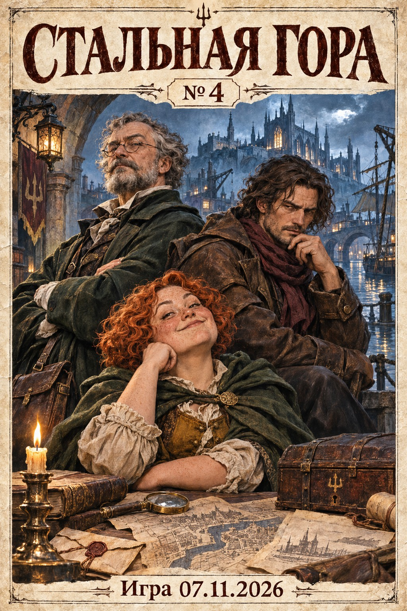

# Стальная гора №4 — игра 07.11.2026

[Скачать PDF](../pdf/Stalnaya-Gora-4-2026-11-07.pdf) · [Каталог серии](../README.md)

20 сюжетных страниц и обложка. Продолжение нумерации: 56–75.

## В этом выпуске

Франц пытается выбраться из портовых неприятностей, Джек ищет работу и улики, Попов возвращается к своим планам, Пиппин просит защиты, а архивариус узнаёт цену выборочной слепоты. Финал оставлен открытым, как в игровой сессии.

## Содержание

- 56. Тактический манёвр
- 57. Две медных в день
- 58. Опоздал на двадцать пять лет
- 59. Для тех, кто не читает
- 60. Серебро и ни одной улики
- 61. Дешёвый ночлег
- 62. Бизнес за ужином
- 63. Сначала доказательства
- 64. Две верёвки
- 65. У каждого свой план
- 66. Надёжнее банка
- 67. Честные торговцы
- 68. Закрытая информация
- 69. Ходи и оглядывайся
- 70. Окно капитана
- 71. Цена разбитого стекла
- 72. Тот же ящик
- 73. Десять серебряных за слепоту
- 74. Доктор рекомендует прогулки
- 75. А где Пиппин?

## Подготовка

Комикс создан по предоставленной расшифровке сессии от 7 ноября 2026 года. Разговорные повторы, броски кубиков и обсуждение интерфейса сокращены; реплики литературно обработаны. Отменённые шутки и планы, которые ещё не исполнились, не выданы за состоявшиеся события. Внешность знакомых героев продолжает рисунки предыдущих выпусков. Франц Дик и Джек показаны разными персонажами.

Рисунки созданы встроенным инструментом генерации изображений. Все страницы прошли визуальную проверку; PDF проверен постраничным рендерингом.

- [Раскадровка и таймкоды](production/storyboard.json)
- [Промпты рисунков](production/prompts.json)
- [Контрольные суммы и порядок страниц](manifest.json)

Полные PNG и CBZ сохранены в локальном проекте. Для GitHub подготовлена версия PDF с JPEG-сжатием без уменьшения разрешения. Исходная расшифровка не входит в публикацию.

