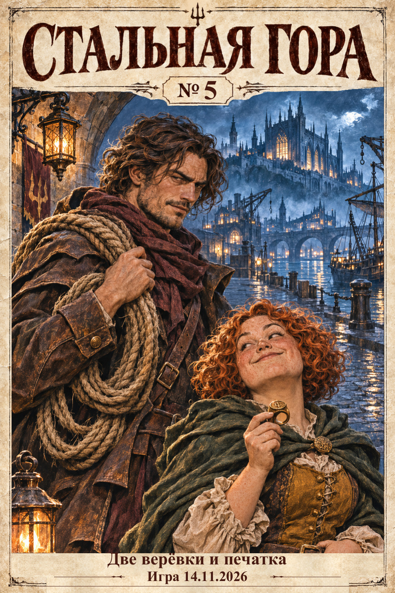

# Стальная гора №5 · Две верёвки и печатка

**14.11.2026** · 20 сюжетных страниц и обложка · страницы 76–95 · 97 кадров

[Читать выпуск в PDF](../pdf/Stalnaya-Gora-5-2026-11-14.pdf) · [Скачать CBZ](Stalnaya-Gora-5-2026-11-14.cbz?raw=true) · [Все выпуски](../README.md)

Пока двое вооружённых людей караулят у храма, Джеку и доктору Попову нужно вывести оттуда Пиппин. У доктора есть плащ, телега и совершенно серьёзное применение для пустого гроба. Тем временем Франц выходит к освещённому окну в лесу, а Клаус в порту выясняет, какие долги можно унаследовать вместе с чужим лицом.

Комикс создан по расшифровке игровой сессии. Диалоги сокращены для рисунка. [Сценарий и таймкоды](production/storyboard.json)

### От страницы 75 к странице 76

На последней странице №4 Пиппин молится у алтаря. В №5 Джек тихо подходит к ней сзади. Обложка №4 и его страницы использованы как прямые образцы рисовки и лиц. Прикосновение Джека к плечу полурослицы и ответный взмах кинжала показаны в отдельных кадрах.

[Сравнить рисунок Пиппин у алтаря в №4 и №5](production/temple-comparison.jpg)
