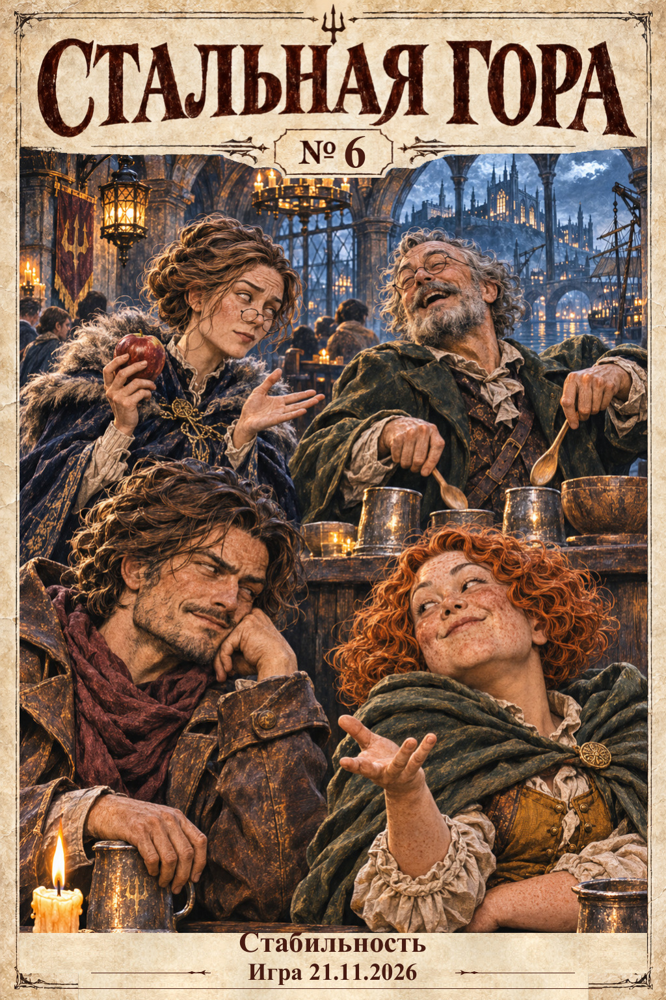

# Стальная гора №6 · Стабильность

**21.11.2026** · 28 сюжетных страниц и обложка · страницы 96–123 · 140 кадров

[Читать выпуск в PDF](../pdf/Stalnaya-Gora-6-2026-11-21.pdf) · [Скачать CBZ](Stalnaya-Gora-6-2026-11-21.cbz?raw=true) · [Все выпуски](../README.md)

Джек собирает «Ключи», чтобы придумать, как избавиться от инквизиции. Разговор выходит обстоятельный, дверь остаётся открытой, а у доктора оказывается неожиданно много слушателей. Тем временем Клаус проверяет старые пути в поместье, Франц выбирается к людям, а Пиппин пытается добиться хотя бы немного стабильности.

Комикс создан по расшифровке игровой сессии. Пиппин и Франц играли с одного ноутбука, Архивариус и Клаус — с другого. Реплики распределены по контексту, действиям и обращениям героев. Диалоги сокращены для рисунка, таймкоды сохранены в [раскадровке](production/storyboard.json).

Лица и рисовка продолжают выпуск №4. Для инквизитора использован визуальный образ дознавателя со страницы 16 выпуска №1; внешность его теневого спутника разработана по описанию новой сессии. Источники образцов и фактические запросы генерации записаны в [production/prompts.json](production/prompts.json).

При покадровой проверке 23.11.2026 просмотрены все 140 кадров и обложка. У Клауса на странице 97 удалена лишняя кисть с кружкой, на странице 96 уточнена сторона руки Франца. Исправленные PDF и CBZ проверены повторно. [Отчёт проверки](production/artifact-audit.json)
